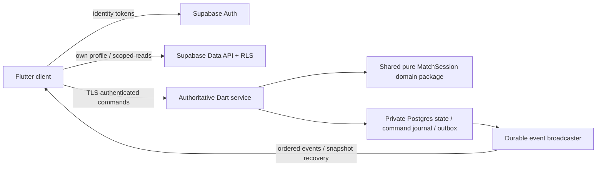

# Online Classic and private rooms — architecture review

Status: **IMPLEMENTED, AWAITING VERIFICATION** for this design artifact only.
Backend/client functionality: **BLOCKED** pending owner architecture acceptance,
provisioned development services and credentials. Nothing here is a shipped API.
Prepared 2026-11-18 after local-mode PRs #54–#63; no deployments or migrations.

## Sources and scope

- [Project hub](https://app.notion.com/p/3f5d7b2be1cc81fea8f5f4b450a42160):
  Supabase identity/profile foundation and a separate authoritative game server.
- [Future lobby proposal](https://app.notion.com/p/416d7b2be1cc81239e97ddcb818b7930):
  membership, versioned rules, invites, reconnect, atomic seating; explicitly future.
- Repository `MatchSession`, immutable `LudoGame`, mode registry, saved-match codecs
  and approved local Classic/Quick/Team contracts remain authoritative.
- Latest owner prompt requires backend design/review before implementation.

First increment proposed: private **Classic 2/4-seat** rooms, explicit local roster
color mapping, authenticated participants, ready/start, reconnect and rematch.
Three-seat local Classic is implemented; online seat availability remains a
separate acceptance gate. Public matchmaking, Quick/Team online, tournaments,
rankings, payments, coin settlement and social chat are outside this increment.
They cannot be implied by a working room UI. Do not expose room actions in the
public app before the complete server path and security gates pass.

## Components and authority

Extract the existing pure Dart domain/application files into a shared package in
a focused follow-up, retaining import-boundary tests and identical deterministic
fixtures. Do not port rules to SQL/JavaScript or build another engine. Flutter
presentation stays in the mobile package. A server adapter obtains actor IDs from
verified membership, injects its accepted die value and invokes MatchSession.
A separate long-running Dart HTTPS/WebSocket service is recommended over treating
Supabase Realtime broadcast messages or client writes as game authority.

Postgres is the durable source for room membership, match snapshots, accepted
commands and results. Each command transaction locks the match row, validates the
current lease/fencing generation and commits state, receipt and outbox together.
One process may own many matches; concurrent workers cannot both commit a version.
A room/match actor is a scheduling optimization, not a substitute for database
concurrency control. Initial deployment can use one region; topology/capacity and
service provider require review before provisioning or operational promises.

## Identity, data access and secrets

Use verified Supabase access tokens with signature, algorithm allowlist, issuer,
audience and expiry checks. Refresh/re-authenticate expired WebSocket sessions;
never treat a previously opened socket as permanent authorization. Use maintained
JWT verification libraries, current signing-key/JWKS rotation guidance and bounded
key caching. Server membership, not client seat/name or editable `user_metadata`,
determines permissions. Anonymous Auth accounts, if enabled, are still authenticated
roles; membership and rate checks remain mandatory. Login providers and guest
upgrade/account-deletion UX need product acceptance.

Flutter receives only a publishable key and user session credentials, never a
secret/service-role key, database password, server signing key or invite digest.
Store server secrets in the selected deployment secret manager. Do not log tokens,
raw invite codes, chat, private profile data or full command payloads by default.
Use separate development/staging/production projects and least-privileged server
DB roles. Core match/receipt/outbox tables live in an unexposed private schema with
no client grants. Explicitly grant only intended profile/membership read objects;
enable and test RLS on every exposed table. Views must preserve invoker security;
no generic SECURITY DEFINER permission workaround. Never infer access from
`TO authenticated` alone. Own-profile updates must constrain both existing owner
and resulting owner. Public display names never become IDs.

Proposed data contracts (not migration SQL):

| Entity | Server-controlled fields / invariants |
| --- | --- |
| Profile | auth user ID, validated display name; no client role/team authority |
| Room | immutable ID, host ID, mode/profile version, seat count, state/version, expiry |
| Room member | room/user uniqueness, fixed seat uniqueness, readiness, join status |
| Invite | digest, room, expiry, revoked/used state; raw token shown only to authorized host |
| Match | match ID, room ID, rules/config, immutable roster, snapshot/version, lease generation |
| Command receipt | match/actor/command-ID unique, canonical request hash, accepted/rejected response |
| Outbox | match/version/event sequence unique, payload version, publish status |
| Result | match unique, server-validated final state, final finisher, participants |
| Rematch proposal | prior match, new readiness, new match ID; never mutate old results |

## Room lifecycle

Proposed state machine: OPEN → STARTING → IN_MATCH → COMPLETED → EXPIRED.
Host creates a versioned room and takes an eligible canonical seat. Join validates
identity, invite scope/expiry, capacity, block restrictions and membership in one
transaction. Seat changes/readiness use expected room version; a seat change
clears the affected readiness. Start locks room and roster, requires all required
seats ready, allocates exactly one match and broadcasts its immutable configuration.
Retries return the same match. No coin charge or hidden bot fill.

Generate invite secrets with a CSPRNG (recommend at least 128 bits); store a keyed
digest, enforce expiry/revocation and bound attempts by account/IP/room. Grouped
base32 codes or secure share links are recommended; a shorter human code needs
separate entropy/rate-limit review. Errors must not enumerate private rooms/users.
Host departure before start, lobby expiry duration and invite reuse policy require
owner acceptance rather than arbitrary implementation defaults.

## Authoritative command protocol

Versioned conceptual envelope:
`{protocolVersion, matchId, commandId, expectedVersion, action, payload}`.
Actions initially: requestRoll, selectPawn(pawnIndex). No client dice, capture,
finished count, turn recipient or winner fields. Actor identity is derived from
verified connection and membership; reject unknown fields and oversized frames.

1. Authenticate, check expiry, membership, room/match status and command rate.
2. Lock match, verify worker fencing token; look up durable command receipt first.
3. Same ID and same canonical request returns its original response without RNG,
   transition or event. Same ID with different payload is a conflict.
4. Check expectedVersion and turn ownership; reject stale/unauthorized commands
   before generating a die. Return an authorized snapshot/version for recovery.
5. For an accepted roll only, sample uniform 1..6 using server CSPRNG; supply it to
   the existing domain command. The animation cannot generate another result.
6. Apply MatchSession transition and atomically commit snapshot, version, ordered
   events, receipt and result/outbox if completed. Publish only committed events.
7. Broadcast with `(matchId, stateVersion, eventSequence)` ordering. Clients dedupe
   on those values; gaps trigger authorized snapshot resync. Never replay an old
   pawn animation when restoring a snapshot that already contains its outcome.

Rejected commands must have bounded durable receipts too; define retention/quotas
so an authenticated attacker cannot grow storage indefinitely. Preserve receipts
for the entire supported match/reconnect window; compact only with an explicit
protocol rule. Domain snapshot's bounded ID history alone is insufficient for
network retries after long matches. A crash before commit cannot publish a result;
a retry after commit obtains the stored result even if the original ACK was lost.
Server dice are not automatically a publicly verifiable fairness protocol. Commit/
reveal, audit disclosure and cryptographic claims require a separate reviewed spec.

## Reconnect, interruption and results

Reconnect revalidates identity and match membership, then supplies a durable
snapshot plus event cursor. Session replacement prevents two devices submitting
as the same player simultaneously without an explicit policy. Do not restore a
local random source or trust a client-supplied saved game for online recovery.
Database restart, worker loss and outbox retries must preserve command outcomes.
The UI can animate speculative feedback but cannot move an authoritative pawn
until acceptance; cancellation returns to confirmed state.

**Undecided:** disconnect grace duration, clock/timeout rules, abandonment/forfeit,
host transfer, AI substitution and mid-match account bans. Until approved, online
release is blocked; do not invent results or silently transfer a human to AI.
Match result derives solely from terminal domain state. Rematch is a new match
with explicit participant readiness and fresh IDs; old receipts/results remain
immutable. No tournament advancement consumes client-reported winners.

## Security and load acceptance before availability

- Two accounts cannot read or mutate each other's private rooms/saves/profiles;
  outsiders/expired tokens/removed members cannot subscribe or submit commands.
- Duplicate and altered-ID retries, stale versions, simultaneous roll/move, ready/
  start races and multiple workers produce one committed transition/result.
- Exhaustive rules/profile parity tests run against the shared domain package;
  seeded offline transcripts replay identically with supplied server die values.
- Restart service/database and disconnect between commit, ACK and broadcast;
  reconnect must obtain identical outcome and no repeated animation/roll.
- Invite guessing/reuse/revocation/expiry, oversized messages, flood limits,
  authorization errors, JWT rotation/revocation and private-schema grants tested.
- RLS tests use anonymous role, authenticated outsider, member and server role,
  including ownership-changing updates. Run DB advisors before review.
- Stage realistic concurrent rooms and 16-pawn/event bursts; record hardware,
  duration, p50/p95/p99 command/ACK/reconnect latency, DB locks, queue depth,
  disconnect/error rates and resource usage. No numerical SLO is claimed before
  a supported deployment scale is agreed and measured.
- Observability uses correlation IDs and redacted reason codes; backup/restore,
  secret rotation, incident runbook and alert ownership must be exercised.

## Dependency-ordered implementation PRs after acceptance

1. Shared pure-domain package extraction, parity fixtures, server test harness.
2. Dev-only Auth/profile foundation with pinned SDK/lockfile, own-row RLS tests.
3. Private room lifecycle, invite permissions, concurrency and expiry tests.
4. Durable MatchSession command adapter, receipts/outbox/reconnect tests.
5. Live Flutter lobby/Classic transport adapter, clear offline/online identity.
6. Staging security/load/failure tests, supported limits and runtime evidence.
7. Owner online acceptance and availability flag review; then tournament design.

Supabase docs checked 2026-11-18:
[changelog](https://supabase.com/changelog.md),
[Data API grants/RLS](https://supabase.com/docs/guides/api/securing-your-api),
[JWT validation/rotation](https://supabase.com/docs/guides/auth/jwts).
Relevant linked changes reviewed: Flutter SDK v3 type-safety changes, CLI v3
local-default behavior and explicit Data API exposure/grants. No remembered SDK
signature, CLI flags or migration schema is prescribed by this RFC. Verify current
versions and commands when implementation is authorized; pin tested dependencies.

## Acceptance requested

Review the component split, initial private Classic scope, durable command/journal
protocol and identity/access model. Required follow-up inputs: development project
access, server hosting/region, supported scale and the unresolved lifecycle/account
policies above. Approving the design does not approve a production deployment,
monetization, tournament rules or a fabricated security/performance verdict.
